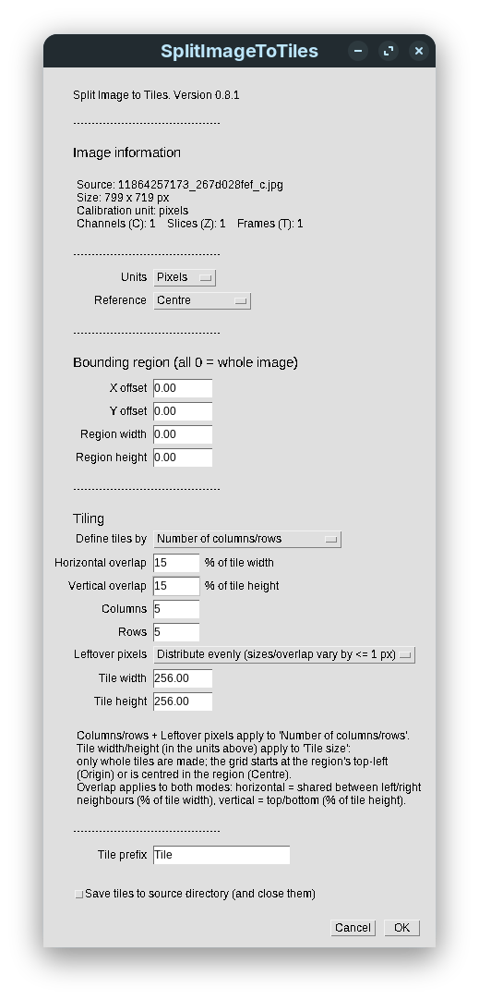
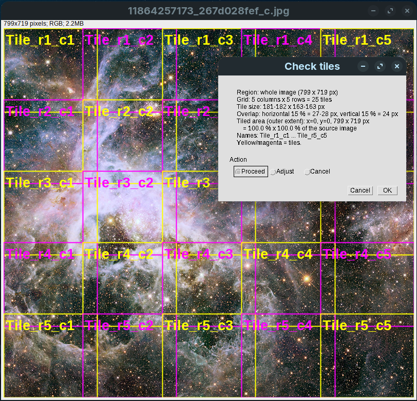

# Split image to tiles (destitcher)

## Description
Divide an image or stack into a tiles of either designated dimensions (Px / uM), or distribute a specified quantity of tiles across the whole image

## Installation
In FIJI: Help > Update > Manage Update Sites > Select SplitImagetoTiles > Apply and Close > Restart FIJI

## Usage
1. Open an image or stack
2. Start the plugin: Plugins > Split Image to Tiles (destitcher)  
    
3. Select units (for dimensions, bounding, offset)
4. Select the reference (origin or centre of image)
5. Define optional starting offsets (where to commence plotting regions)
6. Define an optional bounding region (maximum area of image to use)
7. Select the tiling method (nRows, nColumns or tile size)
    - If using nTiles, define the number of rows/columns  
    - If using tile size, define the target tile dimensions
8. Define optional overlap between tiles
9. Define the tile naming prefix
10. Select whether to save output tiles (otherwise they'll be opened as new windows)
11. Click 'Ok'.  

A preview window indicating the tile regions will be shown with an option to proceed, adjust parameters or cancel the operation.  
  

## Author information
Michael La Roche  
David Richmond Laboratory - Faculty of Medicine and Health - The University of Sydney

## Development notes
Core code by author with feature additions assisted by Claude Code.

## Licence
BSD 2-Clause (See Git for licence information)

## Sample image attribution
"Star-forming Complex 30 Doradus from the Hubble Space Telescope" by HubbleColor {Zolt} is marked with Public Domain Mark 1.0. https://creativecommons.org/publicdomain/mark/1.0/?ref=openverse.
